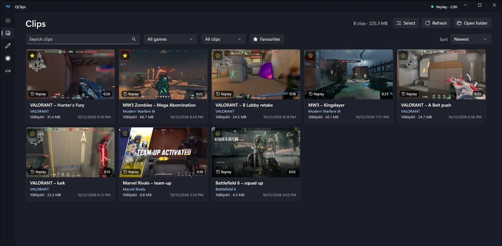
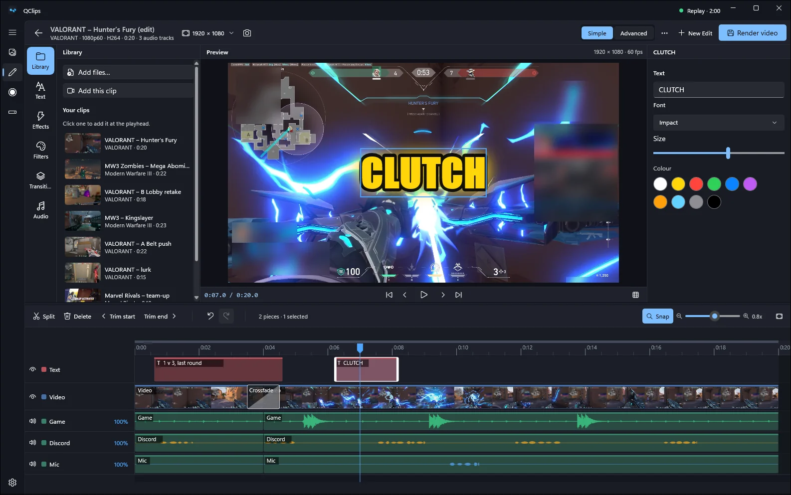
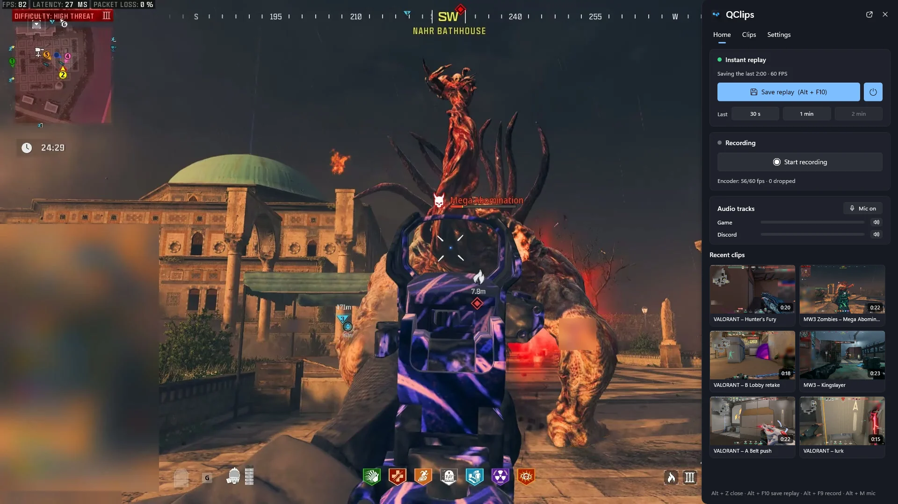

<h1 align="center">QClips</h1>

<b>Play first. Clip it after.</b> Free game clipping for Windows.

  <a href="https://github.com/F2isalq/QClips-Releases/releases/latest/download/QClips-Setup.exe"><b>Download QClips for Windows</b></a>
  &nbsp;·&nbsp; <a href="https://f2isalq.github.io/">Website</a>

QClips is a light Windows app that keeps an instant replay of your game, saves a clip with a hotkey
or a voice command, and lets you trim, edit, caption and share it in seconds. Everything runs on your PC.
QClips is in English and Arabic.

[العربية](#بالعربي)

## Download

Get the newest version from the [latest release](https://github.com/F2isalq/QClips-Releases/releases/latest):

- **[QClips-Setup.exe](https://github.com/F2isalq/QClips-Releases/releases/latest/download/QClips-Setup.exe)**
  (about 5 MB): the small installer. It downloads the rest while it installs.
- **[QClips-Setup-Offline.exe](https://github.com/F2isalq/QClips-Releases/releases/latest/download/QClips-Setup-Offline.exe)**
  (about 240 MB): everything inside, voice commands included, for a PC without a good connection.

QClips installs for your user only, with no administrator rights, and keeps itself up to date. Its updates download
only what changed.

### Windows SmartScreen

The installers are not code-signed yet, so Windows may show "Windows protected your PC" the first time. Click
**More info → Run anyway**. Download QClips only from this page.

## Screenshots

Game names and gameplay footage belong to their owners; QClips isn't affiliated with or endorsed by them.

## Features

- **Instant replay:** the last minutes are always kept; save them with a hotkey, from the tray or the Alt+Z panel.
  Several save hotkeys, each with its own length, on keys or a mouse side button. Optionally, the replay runs only
  while a game is running.
- **Voice commands in Arabic and English:** say a phrase ("clip it", "clip that" or your own) and QClips saves the
  length you chose for it. Recognition runs offline on your PC, and the voice models come with QClips: nothing to download.
- **Sound in sync:** sound and picture line up in every player, including Windows' own player and Discord.
- **Separate audio tracks:** game, voice chat, microphone and any device on its own track, plus a Mixed track; a
  program's sound (Discord, Spotify, the current game) on its own track.
- **Editor:** trim, split, speed, freeze frame, Auto Cut of silent parts, titles and subtitles, effects, colour
  looks, filters and transitions, tracks, keyframes and masks. Render presets: Original, High, Discord 20 MB and
  Discord 50 MB (two passes so the file fits).
- **Automatic captions** in Arabic (Gulf, Saudi, Egyptian, Levantine and Iraqi, with English gaming words) and
  English, timed word by word, with styles you can change and every line editable. Captions are made on your PC.
- **Share** to X, TikTok, Instagram Reels and YouTube Shorts from inside QClips: trim, vertical framing, title and
  description are prepared for you, and you press the platform's own Post button.
- **Screenshots** of a monitor, all monitors, a window or a region, straight to your clipboard, and **copy text from
  the screen** with Windows' own text recognition.
- **Watch your clips** in QClips' own player, with previous and next clip.
- **HDR monitors** are recorded right (converted to normal video), or as HDR10 if you choose.
- **Alt+Z panel** over your game: recent clips, a quick trim, screenshots, pause/resume and the main settings.
- **Storage page:** see your drive, move clips to another drive, name files your way, and an optional limit that
  sends the oldest clips to the Recycle Bin (favourites are kept).
- **Recording** with pause and resume, a performance overlay (FPS, GPU, CPU), "clip saved" notifications, and every
  monitor if you want.
- Uses your graphics card's encoder: NVIDIA NVENC, AMD AMF or Intel Quick Sync, with H.264, HEVC or AV1.

## Requirements

- Windows 10 version 2004 (build 19041) or later, or Windows 11, 64-bit (x64).
- A graphics card with a video encoder is recommended (NVIDIA NVENC, AMD AMF or Intel Quick Sync). Without one,
  QClips records with the processor (x264), which costs more CPU.
- About 420 MB for the app (voice commands included), plus room for your clips and the replay cache.
- Captions: a one-time download of the speech model and the captions engine the first time you use them (about
  610 MB; choosing English downloads an English model of its own, about 550 MB).
- Sharing to a platform needs Microsoft Edge WebView2 Runtime, which comes with Windows 11.

## Privacy

- **Everything stays on your PC.** No QClips account, no cloud, no ads. Nothing is uploaded unless you share a clip
  to a platform yourself.
- **No telemetry.** QClips sends no usage data, no analytics and no crash reports. It only goes online to check for
  and download updates from this page, to download the caption files when you ask for them, and, when you
  use sharing, to open the platform's own pages and check its list of what to look for on them (at most once a day).
- **Voice and captions run offline.** What the microphone hears and what your clips say are recognized on your PC and
  never leave it; only a matched voice phrase is written to QClips' own log.
- **Your passwords stay with the platforms.** You sign in on each platform's own page; QClips never sees or keeps your
  password, and QClips never posts for you.
- A diagnostic report is made only when you click Copy diagnostic report, and goes only where you paste it.

## Anti-cheat safety

QClips records the screen the way Windows' own tools do (Windows Graphics Capture) and the sound through Windows'
audio system. It does **not** hook into games, inject anything, read or open game processes, install keyboard or mouse
hooks, or need administrator rights. Per-app audio also works without opening the game's process.

## Licenses and credits

QClips is free to use. It is built with these projects (the full list and license texts are in
THIRD-PARTY-NOTICES.txt in the install folder):

- **FFmpeg**: QClips runs FFmpeg as a separate program. The bundled build includes x264 and is licensed under the GNU
  GPL version 2 or later; the license, the exact source archive and the build settings are in the ffmpeg folder of
  the install and in THIRD-PARTY-NOTICES.txt.
- **Moonshine** speech models: English (MIT License) and Arabic, used under the Moonshine AI Community
  License. **Powered by Moonshine AI.**
- **Silero VAD** (MIT License): finds speech in the microphone sound.
- **sherpa-onnx** (Apache License 2.0) and **ONNX Runtime** (MIT License): run the voice models.
- Captions: the **Whisper large-v3-turbo** speech model (MIT License), its dialectal Arabic fine-tune
  oddadmix/whisper-large-v3-turbo-arabic-dialectal-v2 (Apache License 2.0), and **whisper.cpp** and **ggml** (MIT
  License); the license texts come with the caption files.
- **Velopack** (MIT License): installs and updates.
- NAudio, Serilog, SQLite, Markdig, the Windows App SDK, WebView2, Win2D and the .NET runtime.

---

## بالعربي

**QClips** برنامج خفيف لويندوز يحتفظ بآخر دقائق من لعبك، ويحفظ المقطع بزر أو بأمر صوتي، وتقدر
تقصّه وتعدّله وتكتب له ترجمة وتشاركه بثواني. كل شيء يشتغل على جهازك، والبرنامج بالعربي والإنجليزي.

### التنزيل

من [آخر إصدار](https://github.com/F2isalq/QClips-Releases/releases/latest):

- **QClips-Setup.exe** (حوالي 5 ميقا): المثبّت الصغير، يحمّل الباقي وهو يثبّت.
- **QClips-Setup-Offline.exe** (حوالي 240 ميقا): كل شيء بداخله مع الأوامر الصوتية، لجهاز اتصاله ضعيف.

يتثبّت لحسابك بدون صلاحيات مدير، وQClips يحدّث نفسه بعدها، والتحديث يحمّل اللي تغيّر بس.

**تنبيه SmartScreen:** المثبّت غير موقّع للحين، فممكن يطلع لك "Windows protected your PC". اضغط
**More info ← Run anyway**.

### المزايا

- إعادة فورية: آخر الدقائق محفوظة دايماً، احفظها بزر أو من الـ tray أو لوحة Alt+Z، وأكثر من زر حفظ كل واحد بطوله.
- أوامر صوتية بالعربي والإنجليزي: قل الجملة وQClips يحفظ الطول اللي اخترته لها، والتعرّف على جهازك بدون نت، ونماذج الصوت تجي مع البرنامج بدون تحميل.
- الصوت متزامن مع الصورة في كل مشغّل، حتى مشغّل ويندوز وديسكورد.
- تراكات صوت منفصلة: اللعبة والمايك وكل جهاز بتراك، وصوت أي برنامج (ديسكورد، سبوتيفاي، اللعبة الحالية) بتراك لحاله.
- محرر واحد فيه القص والسرعة والنصوص والترجمة والمؤثرات والفلاتر والانتقالات، وإعدادات تصدير جاهزة: الأصلي،
  وعالية، وDiscord 20 MB، وDiscord 50 MB.
- ترجمة تلقائية بالعربي (خليجي وسعودي ومصري وشامي وعراقي مع كلمات القيمنق الإنجليزية) وبالإنجليزي، كلمة بكلمة،
  وتشتغل على جهازك.
- مشاركة المقاطع على X وتيك توك وإنستقرام ريلز ويوتيوب شورتس من داخل QClips، وأنت اللي تضغط زر النشر.
- لقطات شاشة (شاشة، كل الشاشات، نافذة، أو منطقة) تنسخ مباشرة للحافظة، ونسخ النص من الشاشة.
- لوحة Alt+Z فوق اللعبة، وصفحة التخزين (نقل المقاطع، تسمية الملفات، وحد اختياري يرسل الأقدم لسلة المحذوفات والمفضلة محمية).
- يستخدم معالج الرسوميات للترميز: NVIDIA NVENC أو AMD AMF أو Intel Quick Sync.

### المتطلبات

- ويندوز 10 إصدار 2004 أو أحدث، أو ويندوز 11، 64-بت.
- يُفضّل كرت شاشة فيه مرمّز فيديو (NVENC أو AMF أو Quick Sync)، وبدونه يسجّل بالمعالج (x264).
- حوالي 420 ميقا للبرنامج (مع الأوامر الصوتية)، غير مساحة المقاطع.
- الترجمة التلقائية تحتاج تحميل ملفاتها مرة وحدة أول ما تستخدمها: حوالي 610 ميقا.

### الخصوصية

- كل شيء يبقى على جهازك: لا حساب QClips ولا سحابة، وما ينرفع شيء إلا إذا شاركت المقطع بنفسك.
- لا يرسل أي بيانات استخدام ولا تحليلات. يتصل بالنت بس عشان التحديثات من هذي الصفحة، وتحميل ملفات الترجمة إذا
  طلبتها، وصفحات المنصات لما تشارك.
- الصوت والترجمة يشتغلون على جهازك وما يطلع منه شيء، وكلمة المرور تكتبها في صفحة المنصة نفسها وQClips ما يشوفها.

### الأمان مع أنظمة مكافحة الغش

QClips يسجّل الشاشة بطريقة ويندوز نفسها (Windows Graphics Capture)، وما يحقن شيء في الألعاب، ولا يفتح عملياتها،
ولا يركّب hooks للكيبورد أو الماوس، ولا يحتاج صلاحيات مدير.

### التراخيص

FFmpeg (رخصة GPL، التفاصيل في THIRD-PARTY-NOTICES.txt)، ونماذج Moonshine (العربي بموجب Moonshine AI Community
License، **Powered by Moonshine AI**)، ونموذج Whisper large-v3-turbo وwhisper.cpp للترجمة (MIT)، وSilero VAD،
وsherpa-onnx، وONNX Runtime، وVelopack، وغيرها في THIRD-PARTY-NOTICES.txt.
